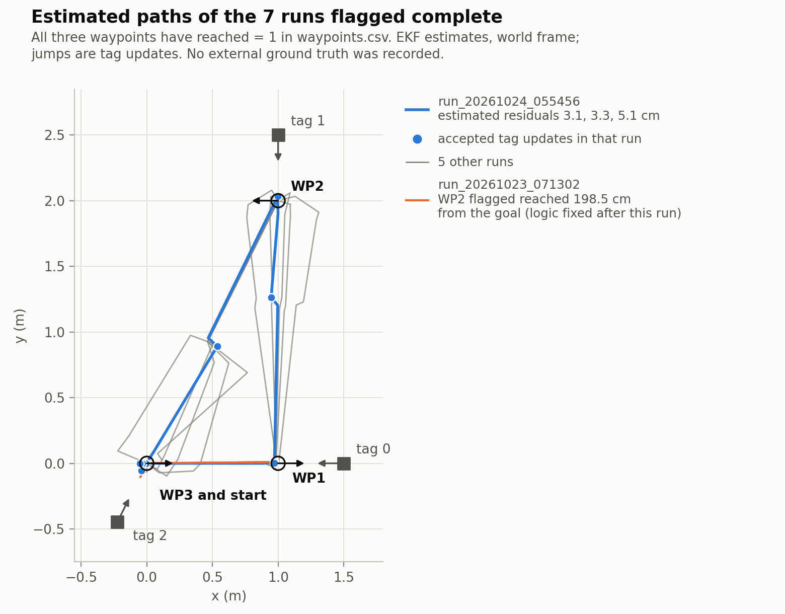
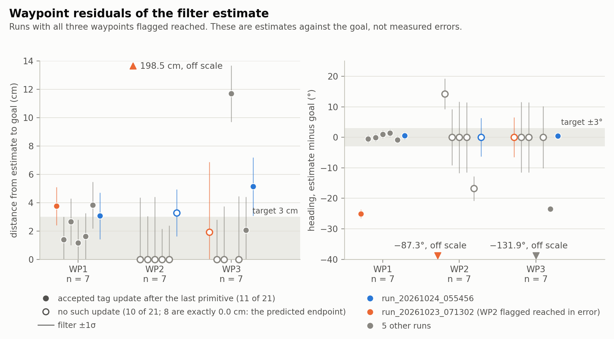
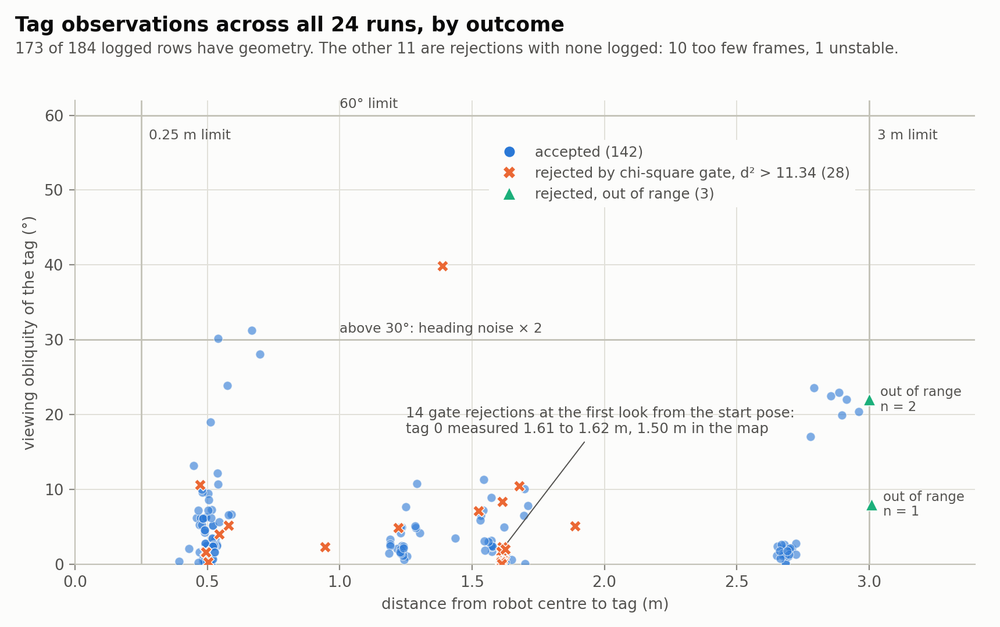
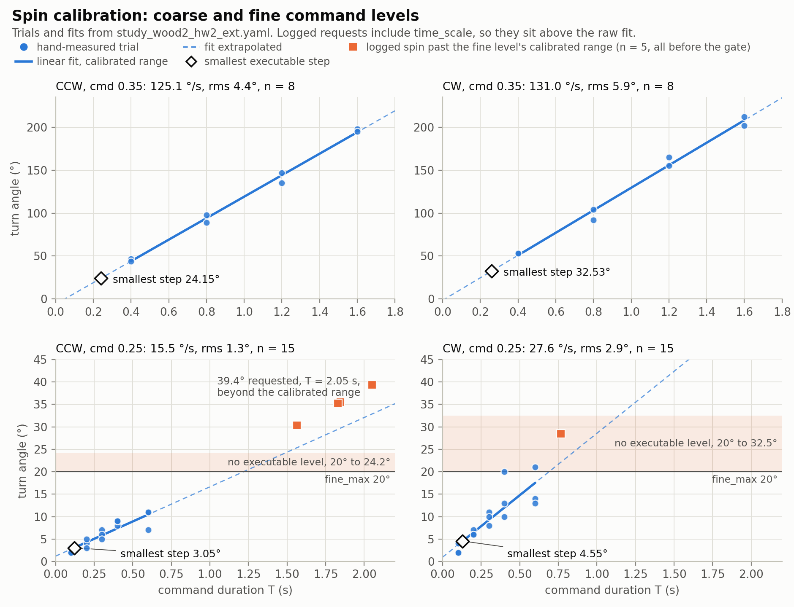

# Closed-Loop Waypoint Navigation with AprilTags on a Rubik Pi Rover

A rover with timed motor commands and no odometry or IMU input drives through three waypoints, correcting its pose estimate only from AprilTag observations taken while it is stopped.

**Status.** Course project, UCSD CSE 276A, fall 2026, two authors. All pose numbers are filter estimates; no external ground truth was recorded.

<p align="center">
  
</p>

**Figure 1.** Estimated robot position for the 7 runs flagged complete. Discontinuities are EKF updates from tag looks. In `run_20261023_071302`, WP2 was flagged reached 198.5 cm from the goal. [Demo video](https://www.youtube.com/shorts/DX3TtBoyumA).

## Overview

The route is fixed by the assignment: start at (0, 0, 0°), then visit (1, 0, 0°), (1, 2, 180°) and (0, 0, 0°), in metres and degrees. A Rubik Pi 3 [6] runs ROS 2 Jazzy [5] on a rover base with an OV5647 camera. Three AprilTag 36h11 markers [1, 2], 16.6 cm wide, stand at hand-measured positions (`landmarks.yaml`). The camera and AprilTag nodes are provided by the course [7, 9]. This project adds intrinsic camera calibration, primitive calibration, an SE(2) extended Kalman filter, a waypoint navigator, run logging and a simulated rover. Between tag looks the navigator knows only the nominal length of each motion primitive.

## Method

Each motion is an open-loop primitive: a fixed wheel command held for a calibrated duration. After every primitive the robot settles for 1 s and collects tag detections for 1 s. It then applies an EKF update for each accepted tag and plans the next primitive from the new estimate. Parameter values below come from `robot_control/config/hw2/nav.yaml`, and [`docs/method.md`](docs/method.md) has the Jacobians, control rules and parameter table.

### Motion model

The state is $\mathbf{x} = [x, y, \theta]^\top$. The filter predicts once per primitive [3], using the nominal amount:

$$
\text{drive } d:\ \ \mathbf{x}^+ = \mathbf{x} + [d\cos\theta,\ d\sin\theta,\ 0]^\top
\qquad
\text{spin } a:\ \ \theta^+ = \theta + a
$$

Process noise grows with the primitive. For a drive, the along-track standard deviation is $0.08\,d + 0.01$ m, the cross-track is $0.03\,d$ m and the heading is 2° per metre. For a spin, the heading standard deviation is $0.05\,|a| + 2°$.

### Observation model

An observation is the tag centre and outward normal direction in `base_link`, $\mathbf{z} = [x_b, y_b, \psi]^\top$. For a landmark at $\mathbf{p}_l$ with normal direction $\psi_l$:

$$
h(\mathbf{x}) = \begin{bmatrix} R(\theta)^\top(\mathbf{p}_l - \mathbf{p}) \\ \psi_l - \theta \end{bmatrix}
$$

Measurement noise depends on the distance $d$: $\sigma_{xy} = 0.005 + 0.01\,d^2$ m and $\sigma_\psi = 1.5° + 1.5°\,d$, doubled above 30° obliquity.

### Gating

Observations pass two stages. Within a look, a tag needs at least 3 frames, a position standard deviation of at most 2 cm, a distance of 0.25 to 3 m and an obliquity of at most 60°. The filter then rejects an observation when the squared Mahalanobis distance of its innovation exceeds the chi-square threshold [4, 8]:

$$
d^2 = \boldsymbol{\nu}^\top S^{-1} \boldsymbol{\nu} > 11.34 \qquad (3\ \text{degrees of freedom},\ 99\,\%)
$$

Two looks in a row with every usable tag rejected halt the run, because that points to a wrong map, camera extrinsic or tag frame.

### Control loop

The planner turns toward the goal, drives, then turns to the goal heading, with targets of 3 cm and 3° (`nav.yaml`). Drives are capped at 1.2 m. Long drives stop short, because the robot has no reverse primitive and an overshoot would mean turning around. A turn that would leave no tag in view is shortened so the last visible tag stays at the edge of the view. A waypoint ends when no move remains or when the next move is smaller than the smallest executable primitive.

## Results

The best run ended with estimated residuals of 3.1, 3.3 and 5.1 cm at the three waypoints, against a 3 cm target (`HW2/logs/run_20261024_055456/waypoints.csv`).

Two points affect how to read this and the tables below:

- **A residual is the filter estimate minus the goal.** It shows where the filter believes the robot stopped, not where the robot actually stopped.
- **`reached = 1` does not mean the target was met.** The flag is also set when the remaining move is below the smallest step (`stop_look.py`, `run_goal`).

Every value below is listed in [`docs/figures/numbers.md`](docs/figures/numbers.md), which `scripts/make_figures.py` generates from `HW2/logs/`.

**Table 1.** Runs by calibration state.

| Calibration state | Runs | All three waypoints flagged reached |
|---|---:|---:|
| Coarse level only | 7 | 3 |
| Adds CW `time_scale` 0.77 | 3 | 3 |
| Adds fine level, cmd 0.25 | 6 | 0 |
| Adds `fine_max_deg` gate | 8 | 1 |
| **Total** | **24** | **7** |

These counts do not show that calibration raised the completion rate. The sample is small, and conditions such as battery level were not logged. Of the 17 incomplete runs, 2 stopped with `no calibrated level`. The other 15 have no terminal record because console output was not saved; 7 of them end the way a filter halt would leave the log (inference).

**Table 2.** Estimated residuals for the 7 runs flagged complete, as position and heading. An asterisk marks a waypoint with no accepted tag update after its last primitive. The 8 entries of exactly 0.0 cm are the predicted endpoint of that primitive, not a measure of accuracy.

| Run | WP1 | WP2 | WP3 | Note |
|---|---|---|---|---|
| `run_20261023_071302` | 3.8 cm, −25.1° | 198.5 cm, −87.3° | 1.9 cm, 0.0°\* | WP2 flagged in error; logic fixed in 9f444fd |
| `run_20261023_072308` | 1.4 cm, −0.5° | 0.0 cm, +14.2°\* | 0.0 cm, 0.0°\* | WP2 turn below the coarse minimum |
| `run_20261024_035816` | 2.7 cm, −0.1° | 0.0 cm, 0.0°\* | 0.0 cm, 0.0°\* | |
| `run_20261024_044445` | 1.2 cm, +1.0° | 0.0 cm, 0.0°\* | 11.7 cm, −131.9° | WP3 turn split to below the coarse minimum (reconstructed) |
| `run_20261024_045017` | 1.6 cm, +1.4° | 0.0 cm, 0.0°\* | 0.0 cm, 0.0°\* | |
| `run_20261024_045200` | 3.8 cm, −0.8° | 0.0 cm, −16.8°\* | 2.1 cm, −23.4° | Turns below the coarse minimum |
| `run_20261024_055456` | 3.1 cm, +0.5° | 3.3 cm, 0.0°\* | 5.1 cm, +0.5° | Only complete run after fine calibration |

In the best run, the commanded motion was 4.924 m and 506.2° over 16 primitives, in 59.5 s with 16.8 s of movement (`steps.csv`). The commanded distance is below the 5.236 m geometric path because tag updates moved the estimate without a commanded drive. The estimated path length is 5.562 m.

Figure 2 plots Table 2 with the filter's uncertainty. Because `reached` only records that the navigator stopped working on a waypoint, a flagged waypoint can still sit far from the goal, as the 198.5 cm point shows.

<p align="center">
  
</p>

**Figure 2.** Waypoint residuals with the filter's 1σ, n = 7 per waypoint. Shaded bands are configured targets, not achieved values.

Across all 24 runs, `observations.csv` holds 184 tag observations: 142 accepted and 42 rejected (28 by the gate, 10 with too few frames, 3 out of range, 1 unstable). Half of the gate rejections came from the first look at the start pose, and 22 of the 28 were tag 0. No observation reached the 60° obliquity limit; the largest logged value is 39.9°.

<p align="center">
  
</p>

**Figure 3.** Tag observations by outcome. The 11 rejections with no logged geometry are not plotted.

## Calibration

Primitives are calibrated from hand-measured trials (`study_wood2_hw2_ext.yaml`). The `verify` section of that file holds a hand-measured check of the open-loop primitives, taken before the fine level was added:

| Primitive | Target | Measured |
|---|---:|---:|
| Drive | 1.0 m | 0.995 m |
| Drive | 1.414 m | 1.413 m |
| Spin CCW | 90° | 90° |
| Spin CW | 90° | 89° |
| Spin CCW | 180° | 176° |

The first navigator runs could not make small heading corrections, because the smallest coarse spin was over 24°. A fine level at cmd 0.25 was added, calibrated from 30 trials at 0.1 to 0.6 s:

| Smallest executable step | Coarse level | Fine level, cmd 0.25 |
|---|---:|---:|
| Spin CCW | 24.15° | 3.05° |
| Spin CW | 32.53° | 4.55° |
| Drive | 0.055 m | not calibrated |

The CW coarse minimum was 24.70° until the CW `time_scale` of 0.77 was added (`study_wood2.yaml`).

Extrapolated past its calibrated range, the fine level was asked for up to 39.4° at T = 2.05 s (`run_20261024_051956/steps.csv`), with observed overshoot, magnitude not logged (`stop_look.py`, `to_step`). The logs hold 5 such spins. The `fine_max_deg` gate (800661d) now limits the fine level to turns of 20° or less. That gate leaves a range of turns with no executable level, shown as the shaded band in Figure 4 and covered under [Known limitations](#known-limitations).

<p align="center">
  
</p>

**Figure 4.** Spin calibration by direction and command level. Requested spins are plotted at their commanded duration, which includes `time_scale`.

## Sensor experiments

The navigator takes no IMU input. In earlier experiments with four slow half turns, the board's fused yaw reported only 18 to 24 % of the rotation (`calibration/README.md`, §2). The data, scripts and notes (in Chinese) are in [`calibration/`](calibration/README.md).

## Tests and simulation

`robot_control/test/` has 85 test functions. The 82 that do not need ROS expand to 93 cases, which pass on a Mac with Python 3.11. The other 3 are ament lint checks (copyright, flake8, pep257) that need a ROS install and were not part of this check. [`tools/`](tools/README.md) has 29 more tests for the SSH teleoperation and calibration tools.

`test_stop_look.py` runs the full navigator against a simulated rover (`sim_rover.py`) that drives 3 % too far, drifts 1.5° per metre and turns 5 % short, with Gaussian noise on motion and tag views. Over 8 random seeds, the tests require the true final pose to be within 4 cm and 4° of each goal, or 8° at WP2. These are pass or fail thresholds, not a measured error distribution. The simulator applies errors to the nominal amount and uses zero-mean tag noise, so it cannot reproduce the fine-level overshoot or the range offset described below.

## Reproduce

These commands run the tests and rebuild the figures and `numbers.md`. They need no robot and no ROS:

```bash
pip install numpy pyyaml matplotlib pytest
```

```bash
PYTHONPATH=robot_control python -m pytest robot_control/test --ignore=robot_control/test/test_copyright.py --ignore=robot_control/test/test_flake8.py --ignore=robot_control/test/test_pep257.py
```

```bash
python -m pytest tools
```

```bash
python scripts/make_figures.py
```

To run on the robot, follow the runbook in [`HW2/hw2_steps.md`](HW2/hw2_steps.md). It covers setup, tag placement, perception checks, calibration and tuning. The node reads its configuration from `~/ros2_ws/src/CSE276A`, so clone the repository to that path on the robot.

## Known limitations

- **No external ground truth.** No run has a tape-measured `truth.yaml`, so localization error and arrival error are both unknown.
- **Unexplained range offset.** From the start pose, tag 0 read 1.574 m on one day and 1.613 m on the next, against 1.500 m in the map. Over the first drive, its measured distance fell by 1.095 m on average for 0.893 m commanded (ratio 1.16 to 1.26, 21 runs), yet the hand-measured check gave 0.995 m for a 1.0 m command. The logs cannot separate a range bias, a map error and a drive error. The estimated residuals could carry the same offset without showing it.
- **Uncorrected turn at WP2.** The 180° goal heading faces no tag, so the last 55° or so of the turn is not corrected. The tests expect this.
- **3 cm target out of reach for some residuals.** The smallest drive is 5.5 cm. A residual between 3 and 5.5 cm ends the position phase, which is why the best run misses the target. All 132 logged drives used cmd 0.3.
- **Gap in executable turns.** The `fine_max_deg` gate allows the fine level only up to 20°, and the coarse minimum is 24.15° CCW and 32.53° CW. Turns between those limits have no level, and the run stops. Two of the 8 runs after the gate ended this way, at −21.1° and −26.6° (`waypoints.csv`).
- **`reached` overstates completion.** See [Results](#results). Any move below the smallest step ends the waypoint with `reached = 1`.
- **Few runs under changing conditions.** Calibration and parameters changed during the 24 runs, and only one run completed after fine calibration. All 24 runs used one floor's calibration.
- **Lost diagnostics.** Console output was not saved, so 15 incomplete runs have no recorded reason for stopping.

### What would change next

- **External ground truth.** Tape-measured poses in the `truth.yaml` that `plot_run.py` already reads would turn the residuals into localization and arrival errors, and would help separate the causes of the range offset.
- **Fine drive calibration.** Calibrating cmd 0.2 is the runbook's route to a smallest drive under 3 cm; it was not done.
- **A fourth tag.** A tag at (0.5, 2) facing +x would give the last turn at WP2 a landmark to correct against (untested).

## Repository layout

| Path | Contents | Origin |
|---|---|---|
| `robot_vision/`, `apriltag_ros/` | Camera and AprilTag nodes | Course template; camera parameters calibrated here |
| `robot_control/robot_control/motor_control.py` | Motor controller node | Course template |
| `robot_control/` (other files) | EKF, navigator, logging, calibration, launch files, config, tests | This project |
| `HW2/` | Runbook, per-run plot tool, logs of all 24 runs | This project |
| `HW1/` | Open-loop runbook and logs | This project |
| `calibration/` | IMU and magnetometer experiments | This project |
| `tools/` | SSH teleoperation and calibration tools | This project |
| `scripts/`, `docs/` | Figure script, figures, method notes | This project |

## Authors and division of work

The project was developed jointly by two authors. This division follows the commit history, except where noted:

**Shengqi Yuan ([`zzyzhbs`](https://github.com/zzyzhbs))**
- IMU and magnetometer experiments (`calibration/`)
- SSH tools and their 29 tests (`tools/`)
- Fine spin calibration (`study_wood2_hw2_ext.yaml`) and the `fine_max_deg` gate
- On-robot runs and the log archive
- Navigation design discussion and parameter tuning (by the author's account, not visible in commits)
- This documentation and the figure script, prepared with AI assistance (Claude)

**[`original-doc`](https://github.com/original-doc)**
- Open-loop framework and its calibration tool (`ol_*.py`)
- EKF, SE(2) geometry, tag observations, navigator, level selection and run logging (`ekf.py`, `se2.py`, `tag_obs.py`, `stop_look.py`, `step_timing.py`, `nav_log.py`)
- ROS nodes (`hw2_nav.py`, `hw2_probe.py`), simulated rover, most of `robot_control/test/`, and the plot tool
- Camera intrinsic calibration (reprojection RMS 0.30 px) and the runbooks

Run logs were committed from both accounts.

**Provided by the course:** the camera and AprilTag nodes and `motor_control.py`, from the course template [7].

## License

Project code is under the [MIT License](LICENSE). `apriltag_ros/` and `robot_vision/` declare MIT in their own `package.xml`. Course-provided files keep their original terms.

## References

1. E. Olson, "AprilTag: A robust and flexible visual fiducial system," *Proc. IEEE ICRA*, 2011, pp. 3400–3407. [doi:10.1109/ICRA.2011.5979561](https://doi.org/10.1109/ICRA.2011.5979561)
2. J. Wang and E. Olson, "AprilTag 2: Efficient and robust fiducial detection," *Proc. IEEE/RSJ IROS*, 2016, pp. 4193–4198. [doi:10.1109/IROS.2016.7759617](https://doi.org/10.1109/IROS.2016.7759617)
3. S. Thrun, W. Burgard and D. Fox, *Probabilistic Robotics*, MIT Press, 2005, ch. 3 and 7.
4. Y. Bar-Shalom, X. R. Li and T. Kirubarajan, *Estimation with Applications to Tracking and Navigation*, Wiley, 2001, §5.4.
5. [ROS 2 Jazzy documentation](https://docs.ros.org/en/jazzy/).
6. [Rubik Pi 3 user manual](https://www.thundercomm.com/rubik-pi-3/en/docs/rubik-pi-3-user-manual/1.1.2/get-started), Thundercomm.
7. [CSE 276A course template](https://github.com/AutonomousVehicleLaboratory/rubikpi_ros2), UC San Diego.
8. Y. Bar-Shalom and T. E. Fortmann, *Tracking and Data Association*, Academic Press, 1988.
9. [`apriltag_ros`](https://github.com/christianrauch/apriltag_ros), C. Rauch, MIT License.

## 中文摘要

UCSD CSE 276A 的双人课程项目：小车运行 ROS 2 Jazzy，停车观测 AprilTag，修正 SE(2) 扩展卡尔曼滤波的位姿估计，依次到达三个航点。24 次实车运行中 7 次标记全部到达，最佳运行估计残差为 3.1、3.3、5.1 cm，未达 3 cm 目标。所有位姿都是滤波估计，没有外部真值。细级标定把最小转角降到 3.05° 和 4.55°，也留下一段无可用档位的转角。
